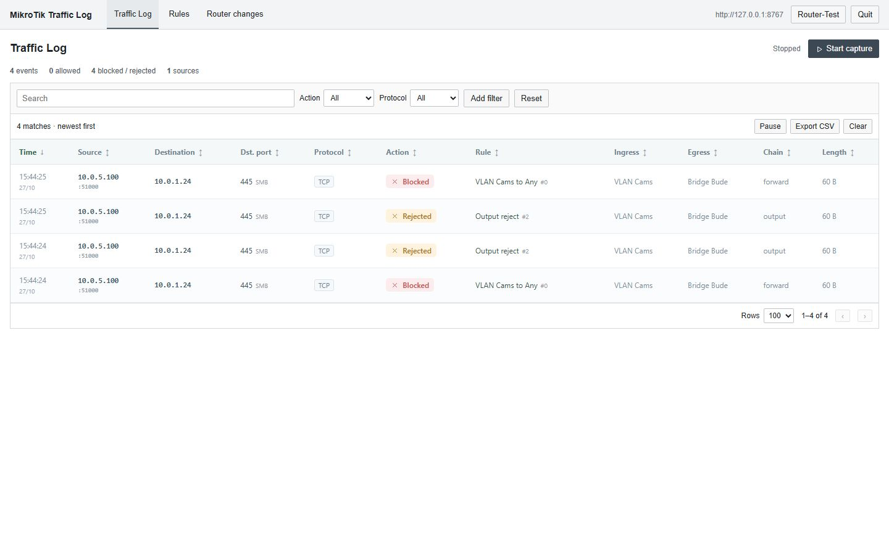

# MikroTik Traffic Log

Portable traffic log viewer for MikroTik RouterOS, with filters for IPs, ports, protocols, actions and rules.



## Start

Requires Python 3.10+ and RouterOS 7 with REST enabled. No additional Python packages.

```sh
python run.py
```

Windows: `start.cmd`. Linux/macOS: `python3 run.py`.

Connect, select rules, start capture. HTTP and the current gateway are prefilled; drop/reject rules are selected by default. The router account needs `read`, `write` and `rest-api` permissions.

## Router changes

Capture adds temporary log rules, a logging buffer and an expiry task. Stop removes them. Setup and rollback commands are available in the UI.

IPv4 filter rules only. FastTrack connections may bypass capture.
